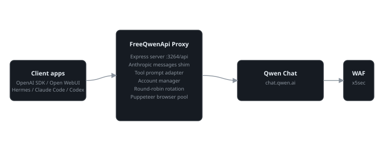
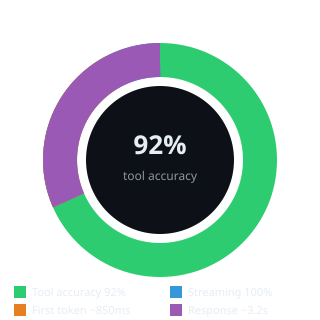

# FreeQwenApi — @Githab-capibara fork

> **Local OpenAI-compatible proxy to Qwen Chat** from [t.me/forgetmeai](https://t.me/forgetmeai).
> Text, Qwen 3.7 models, files, Open WebUI, Hermes/LiteLLM, and now image and video generation via Qwen Chat.

[](https://t.me/forgetmeai)
[]()
[](https://chat.qwen.ai)
[](LICENSE)
[](https://discord.gg/forgetmeai)
[](https://forgetmeai.com)



## What is this

FreeQwenApi turns a Qwen Chat web account into a local OpenAI-compatible API:

```text
http://localhost:3264/api
```

This is **not a local model running on your GPU** and **not the official Alibaba/Qwen API**. It's a practical browser-based proxy: you authenticate in Qwen Chat, the project saves the session, and gives you a local API for your tools.

## Quick start

```bash
git clone https://github.com/Githab-capibara/FreeQwenApi
cd FreeQwenApi
npm install
npm run auth
npm run models:sync
SKIP_ACCOUNT_MENU=true npm start
```

Verify:

```bash
npm run smoke
```

## Benchmarks



| Metric | Value |
|--------|-------|
| First token latency | ~850ms |
| Full response time | ~3.2s |
| Tool call accuracy | ~92% |

## Features

- **Chat Completions API**: `POST /api/chat/completions`, compatible with OpenAI SDK, Open WebUI, LiteLLM, and agents.
- **Current Qwen Chat models**: `qwen3.7-max`, `qwen3.7-plus`, `qwen3.6-plus` and others from `src/AvailableModels.txt`.
- **Image generation via Qwen Chat**: `POST /api/images/generations` without `DASHSCOPE_API_KEY`.
- **Video generation via Qwen Chat**: `POST /api/videos/generations` + task polling via `GET /api/tasks/status/:taskId`.
- **Multi-account**: add, re-login, remove, statuses `OK` / `WAIT` / `INVALID`, automatic round-robin rotation on rate limits.
- **File upload**: upload endpoint for Qwen files and attachments.
- **Open WebUI**: can be connected as an OpenAI-compatible backend.
- **Hermes / OpenCode / Claude Code / Codex / OpenClaw / LiteLLM**: ready instructions for local AI agents and tool-use smoke tests.
- **Health/smoke tooling**: `/api/health`, `/api/status`, `/api/models`, `npm run smoke`, `npm run models:sync`.

## Recommended models

| Model | Use case |
|-------|----------|
| `qwen3.7-max` | Regular chat, agents, Open WebUI |
| `qwen3.7-plus` | Faster and lighter |
| `qwen3-coder-plus` | Coding |
| `qwen3-vl-plus` | Images/video via Qwen Chat |

## Configuration

```bash
cp .env.example .env
```

Most useful parameters for agent clients:

| Variable | Value | Purpose |
|----------|-------|---------|
| `QWEN_TOOL_PROMPT_MODE` | `minimal` | Best for Hermes, OpenCode, Claude Code, Codex, OpenClaw |
| `QWEN_MAX_SYSTEM_CHARS` | `180000` | Safe limit for heavy agent clients |
| `QWEN_USE_NODE_FETCH` | `0` | Keeps requests inside browser (better anti-bot) |
| `NON_INTERACTIVE` | `1` | Start without account menu for daemons |
| `SKIP_ACCOUNT_MENU` | `1` | Skip interactive menu |

Full parameter list: [.env.example](.env.example)

## Documentation

| Guide | Purpose |
|-------|---------|
| [docs/README.md](docs/README.md) | Master index and full documentation map |
| [docs/adr/README.md](docs/adr/README.md) | Architecture Decision Records |
| [docs/guides/01-quick-start-guide.md](docs/guides/01-quick-start-guide.md) | Full quick start with all platforms |
| [docs/setup/01-openwebui-setup.md](docs/setup/01-openwebui-setup.md) | Open WebUI integration |
| [docs/setup/02-image-generation.md](docs/setup/02-image-generation.md) | DashScope/Qwen image endpoints |
| [docs/setup/03-model-sync-summary.md](docs/setup/03-model-sync-summary.md) | Qwen Chat model sync (auto-generated) |
| [docs/integrations/01-integrations-overview.md](docs/integrations/01-integrations-overview.md) | All integration configs (Hermes, OpenCode, Claude Code, Codex, OpenClaw, LiteLLM) |
| [docs/api/01-api-endpoints-reference.md](docs/api/01-api-endpoints-reference.md) | Full API endpoint reference |
| [docs/examples/01-nodejs-examples.md](docs/examples/01-nodejs-examples.md) | Node.js usage examples |
| [docs/examples/02-python-examples.md](docs/examples/02-python-examples.md) | Python usage examples |

## Quick commands

```bash
npm run auth                  # account management
npm run models:sync           # update model list
npm run smoke                 # quick API check
SKIP_ACCOUNT_MENU=true npm start
```

## Limitations

- This is an unofficial browser-based proxy; Qwen may change its internal API.
- Qwen Chat accounts may hit rate limits; use multiple accounts for round-robin.
- Tokens expire — use `npm run auth -- --relogin`.
- Photo/video generation depends on Qwen Chat feature availability on the specific account.
- URLs of generated media may be temporary.
- For production use with caution: this is a tool for experiments, demos, and local workflows.

## From @Githab-capibara

If the fork helped — subscribe: [t.me/forgetmeai](https://t.me/forgetmeai)

There you'll find practical AI tools, local agents, open-source finds, and honest tests without corporate fluff.
